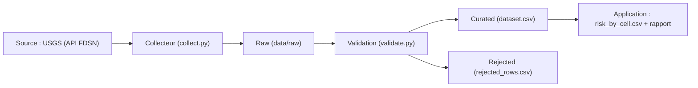

Une ligne représente un séisme enregistré par l'USGS.
Champs : event_id, observed_at, magnitude, mag_type, place, tsunami_flag, status, latitude, longitude, depth_km (+ is_shallow, tsunami_candidate, cell_id calculés).
